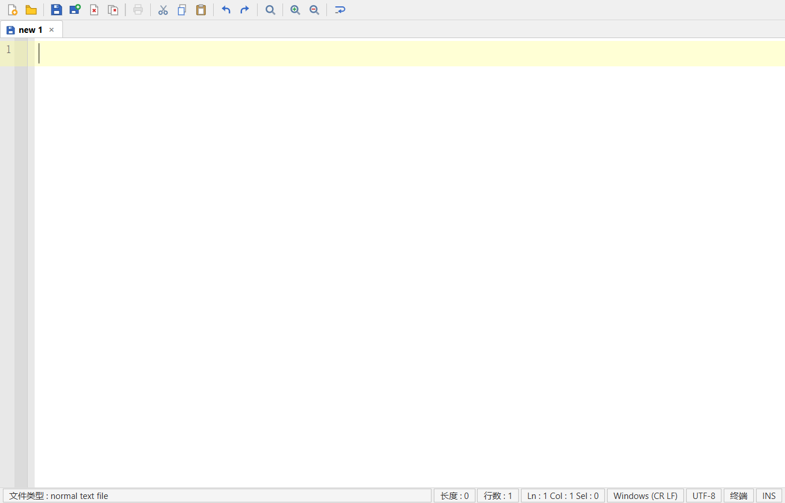
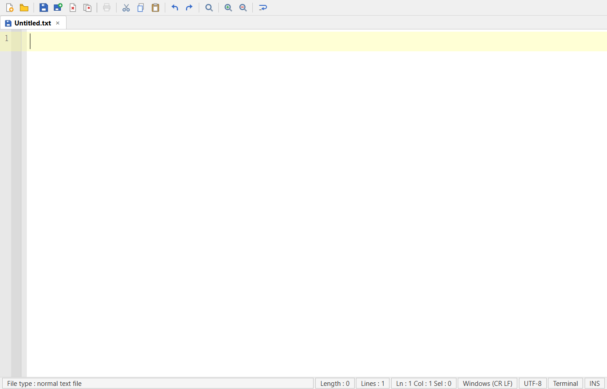

# 墨码 moma

[](LICENSE)
[](https://github.com/hu-kaiqi/moma/releases)

**[简体中文](#简体中文)** ｜ **[English (US)](#english-us)**

---

# 简体中文

按「看懂 → 核对证据 → 用理解重写」的方法论对 Notepad++ 做的**功能与交互复刻**：
UI 与行为对着 Notepad++ 官方源码逐项核对，**代码全新原创**（未抄一行 GPL 代码）。
Electron 45 + CodeMirror 6，界面中英双语（设置▸首选项▸语言，即切即生效）。

> 独立复刻项目，与 Notepad++ 官方无关联；Notepad++ 是其作者的商标。

## 截图

| 中文 | English |
|---|---|
|  |  |

## 功能

- **原生菜单 + 工具栏**：文件/编辑/搜索/视图/编码/语言/设置/工具/宏/插件/窗口/?，快捷键对齐 N++
- **标签页**：蓝/红软盘图标（已存/未存）、每标签独立状态（撤销历史/光标/书签切标签不丢）
- **编辑**：列选（Alt+拖 / Alt+Shift+方向）、书签（点击切换、F2/Shift+F2 跳转）、括号冒号自动缩进、Tab=4 空格、自动补全（可配）
- **编码三态**：ANSI(GBK) / UTF-8 / UTF-8-BOM，探测 + 按原编码保存 + GBK 字节计数
- **N++ 式浮动查找窗**：查找/替换两页、可拖动、F3/Shift+F3、查询高亮
- **视图**：缩放只改文字（Ctrl+滚轮 / Ctrl+=/-/0，持久化）、自动换行（默认关）、行号 + 书签边栏（边栏顺序依 Scintilla 源码核对）
- **底部终端 dock**：逐条执行、GBK 解码、cd/历史；工作目录跟当前文件
- **双击文件打开**：单实例参数转发（Win/Linux/mac）
- **中英双语界面**：zh-CN / en-US，en-US 文案对齐 Notepad++ 官方英文原文

## 下载安装

到 [Releases](https://github.com/hu-kaiqi/moma/releases) 下载（安装包挂在 Release Assets，不进代码仓）：

| 平台 | 文件 | 说明 |
|---|---|---|
| Windows | `moma-Setup-<version>.exe` | NSIS 向导式安装，可自选目录 |
| Linux (amd64) | `moma_<版本>_amd64.deb` | `sudo dpkg -i moma_...deb`，装到 /opt/moma |

各文件的 SHA256 见 Release 说明。**未签名**：Windows SmartScreen 可能拦截（「更多信息」→「仍要运行」）。

## 从源码构建

```bash
git clone https://github.com/hu-kaiqi/moma.git
cd moma
npm install          # 国内可加 --registry=https://registry.npmmirror.com

# Windows：build.cmd  （renderer bundle + Dev-C++ g++ 编译引导程序，双击 墨码.exe 启动）
# Ubuntu： ./build.sh （renderer bundle + 系统 g++ 编译 ./moma）
npm start            # 开发模式直接跑 Electron

# 发布安装包
npm run dist         # Windows NSIS Setup.exe（经 dist-app 混淆产物）
npm run dist:linux   # linux-unpacked/，再 python scripts/build-deb.py release <版本>
```

架构：`launcher.cpp`（Win32）/`launcher-linux.cpp`（POSIX exec）→ Electron（main.js 原生菜单/文件 IO/编码探测 + preload 安全桥 + CodeMirror 6 渲染层）。引导程序用 TDM-GCC 4.9.2（`-std=c++14`）编译，其余部分平台无关。

## 已知局限（诚实声明）

- 安装包未签名（SmartScreen 会提示）
- 终端 dock 是逐条执行（非 pty），交互式程序不支持
- 打印、宏/插件/工具/窗口菜单为占位置灰（对齐「存在感」）
- 编码菜单缺「使用 XX 重新载入」（reload-as）

开发期迭代记录见 [docs/history.md](docs/history.md)。

## 许可证

代码以 [AGPL-3.0-or-later](LICENSE) 发布。UI 复刻的是交互与外观事实（不含任何 Notepad++ 代码）。
依赖：Electron / CodeMirror 6（MIT）。Notepad++ 名称与商标归其作者，本项目不与之关联。

---

# English (US)

**moma** (墨码) is an independent reimplementation of the Notepad++ editing experience, built with a "read it → verify against evidence → rewrite from understanding" methodology: every UI and behaviour detail was checked against the official Notepad++ source code, while **all code is original** (not a single line copied from the GPL codebase). Electron 45 + CodeMirror 6, with a bilingual UI (zh-CN / en-US — switch in Settings ▸ Preferences ▸ Language, applied instantly).

> An independent replication project, not affiliated with the Notepad++ team; Notepad++ is a trademark of its author.

## Screenshots

| 中文 | English |
|---|---|
|  |  |

## Features

- **Native menu + toolbar**: File / Edit / Search / View / Encoding / Language / Settings / Tools / Macro / Plugins / Window / ?, with N++-matching shortcuts
- **Tabs**: blue/red floppy icons (saved/unsaved), per-tab state (undo history, cursor, bookmarks survive tab switches)
- **Editing**: column selection (Alt+drag / Alt+Shift+arrows), bookmarks (click to toggle, F2/Shift+F2 to jump), auto-indent after brackets/colons, Tab = 4 spaces, configurable autocomplete
- **Three-state encoding**: ANSI (GBK) / UTF-8 / UTF-8-BOM — detection, save in original encoding, GBK byte counting
- **N++-style floating Find window**: Find/Replace tabs, draggable, F3/Shift+F3, match highlighting
- **View**: text-only zoom (Ctrl+wheel / Ctrl+=/-/0, persisted), word wrap (off by default), line numbers + bookmark margin (order verified against the Scintilla source)
- **Bottom terminal dock**: one-command-at-a-time execution, GBK decoding, cd/history; working directory follows the current file
- **Open with / double-click**: single-instance argument forwarding (Win/Linux/mac)
- **Bilingual UI**: zh-CN / en-US, with en-US wording aligned to the official Notepad++ English strings

## Download

Grab installers from [Releases](https://github.com/hu-kaiqi/moma/releases) (they are attached as Release assets, never mixed into the code tree):

| Platform | File | Notes |
|---|---|---|
| Windows | `墨码-Setup-<version>.exe` | NSIS wizard installer, custom directory supported |
| Linux (amd64) | `moma_<version>_amd64.deb` | `sudo dpkg -i moma_...deb` (installs to /opt/moma) |

SHA256 checksums are listed in the release notes. **Unsigned**: Windows SmartScreen may warn ("More info" → "Run anyway").

## Build from source

```bash
git clone https://github.com/hu-kaiqi/moma.git
cd moma
npm install

# Windows: build.cmd   (renderer bundle + Dev-C++ g++ launcher; then launch 墨码.exe)
# Ubuntu:  ./build.sh  (renderer bundle + system g++ launcher; then ./moma)
npm start            # dev mode

# Release installers
npm run dist         # Windows NSIS Setup.exe (via the dist-app obfuscated output)
npm run dist:linux   # linux-unpacked/, then: python scripts/build-deb.py release <version>
```

Architecture: `launcher.cpp` (Win32) / `launcher-linux.cpp` (POSIX exec) → Electron (main.js: native menus / file IO / encoding detection + preload security bridge + CodeMirror 6 renderer). The launcher is compiled with TDM-GCC 4.9.2 (`-std=c++14`); everything else is platform-independent.

## Known limitations (honest disclosure)

- Installers are unsigned (SmartScreen will warn)
- The terminal dock executes one command at a time (not a pty); interactive programs are unsupported
- Print, Macro/Plugins/Tools/Window menus are placeholder (greyed out) — presence only
- The Encoding menu lacks "Reload as…" (reload-as)

Development history: [docs/history.md](docs/history.md).

## License

Code is released under [AGPL-3.0-or-later](LICENSE). What is replicated is interaction and look-and-feel facts (no Notepad++ code included). Dependencies: Electron / CodeMirror 6 (MIT). The Notepad++ name and trademark belong to its author; this project is not affiliated.
